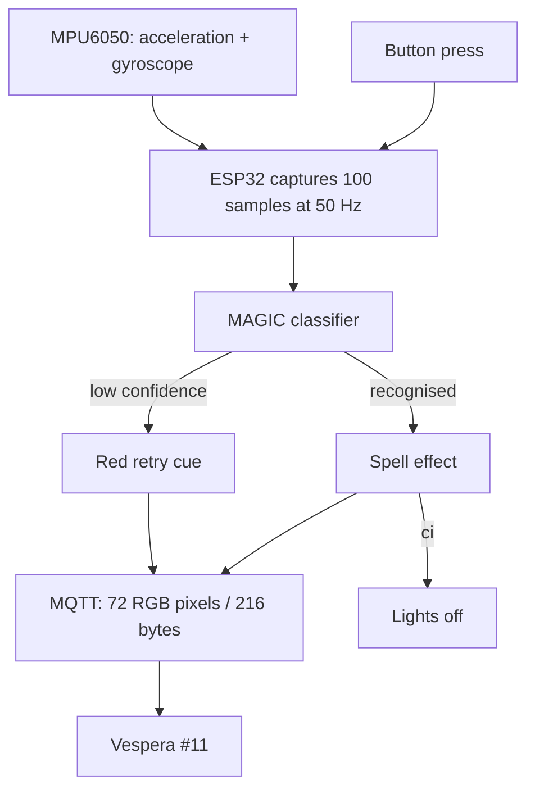

# SPELLBOUND

A gesture-controlled wand for the CASA0014 Vespera luminaire (UCL Connected Environments, 2026).

The wand uses an MPU6050 motion sensor on an ESP32 Feather. Pressing the button starts a 350 ms cyan preparation cue, followed by a two-second capture. An Edge Impulse model classifies the movement and the ESP32 sends RGB animation frames to Vespera #11 over MQTT.

## Final adopted source

The author supplied [`SPELLBOUND_Final.ino`](firmware/final/SPELLBOUND_Final.ino) as the final adopted sketch on 4 Nov 2026; the attached follow-up is a further iteration of that same final version. It uses the MAGIC Edge Impulse export (`MAGIC_inferencing.h`) and acceleration in m/s². The author confirms that this follow-up iteration was run on the prototype. No serial log or diagnostic measurements from that run are included in the repository. The retained serial screenshots show a different build: they include fallback-demo messages that do not exist in this final sketch. They are kept as development evidence, not presented as test logs from this exact file.

The author reports that their prototype demonstrations worked, including gesture recognition and the light effects. A full run-by-run count was not recorded. The Oppugno excerpt at [serial evidence](evidence/serial_logs/2026-11-04_oppugno_AUTHOR_REPORTED.txt) is one inference at 98.4% confidence, not a model accuracy result; its exact firmware build was not recorded.

## How the interaction works

With `CI_TURNS_OFF = true`, `ci` turns the lights off. A low-confidence result flashes red and does not play the earlier candidate's fallback sequence. The capture cue is cyan for 350 ms before sampling and recognised gestures flash purple. The updated source also prints sample timing and sensor saturation diagnostics, and rejects captures below a configurable gyro-motion threshold. These are diagnostic and filtering changes, not evidence of higher recognition accuracy until checked on the physical setup.

## Hardware and wiring

| Part | Connection |
|---|---|
| MPU6050 VCC | ESP32 3V |
| MPU6050 GND | ESP32 GND |
| MPU6050 SDA | GPIO23 |
| MPU6050 SCL | GPIO22 |
| Push button | GPIO27 to GND; `INPUT_PULLUP`, so pressed reads LOW |

The sensor address is 0x68. The ESP32 publishes to Vespera #11 over `mqtt.cetools.org:1884`, topic `student/CASA0014/luminaire/11`.

## Build and run

1. Install the ESP32 Arduino core, Adafruit MPU6050, Adafruit Unified Sensor and PubSubClient.
2. Install the Edge Impulse Arduino export for the MAGIC project. This sketch includes `MAGIC_inferencing.h`; keep only one Edge Impulse Arduino library installed so Arduino IDE cannot pick a different SDK by mistake. The full library is not vendored here; see [models/README.md](models/README.md).
3. Copy [`arduino_secrets.example.h`](firmware/final/arduino_secrets.example.h) to `arduino_secrets.h` in the same folder and fill in your local Wi-Fi and MQTT credentials. The completed file is ignored by Git.
4. Open `firmware/final/SPELLBOUND_Final.ino` in Arduino IDE, select the ESP32 Feather and its port, then open Serial Monitor at 115200 baud.
5. Wait for `[MQTT] Connected!`, then press the button once. Serial commands `g`, `1`–`6` and `o` are also available for casting, previewing and switching the lights off.

The sketch sets `ACCEL_IN_G = false`, so acceleration is passed in m/s². `DIAG_ENABLED` prints sampling interval and saturation information; `MOTION_GATE_ENABLED` rejects very low gyro movement (35 dps by default). `ENABLE_RETRY` is off by default. The source header records checking this against 227 MAGIC samples. Earlier MAGIC2 sketches use a different export and are retained as earlier iterations.

## Project documentation

- [Design process and system overview](docs/design-process.md)
- [Testing and evidence](docs/testing.md)
- [Two-minute crit plan](docs/crit-presentation.md)
- [Known issues and setup notes](docs/known-issues.md)
- [Code inventory and provenance](docs/code-inventory.md)
- [Development log](docs/development-log.md)
- [AI contributions](docs/ai-contributions.md)
- [Edge Impulse training records](evidence/edge_impulse/README.md)
- [Development notes and serial evidence](evidence/development_notes/README.md)
- [Model package notes](models/README.md)

## Development history

| Date | Step |
|---|---|
| 12 Oct | Wi-Fi web page toggling the MKR WiFi 1010 LED |
| 19 Oct | Gesture ideas and model iterations |
| 26 Oct | MQTT colour test, motion threshold and MKR compile problems |
| 29 Oct | 50 Hz data collector and first Edge Impulse model |
| 1 Nov | Data collector moved to ESP32 Feather |
| 2 Nov | MAGIC2 model, gesture tests, MQTT test and integrated button sketches |
| 3 Nov | Visual-effects candidate with countdown cue and fallback demos |
| 4 Nov | Author supplied the final adopted MAGIC sketch |

Earlier visual-effects candidate and v4 files remain available as development versions. See [development-log.md](docs/development-log.md).

## Contributions and AI use

The author reports doing the hardware setup, gesture-data collection, Edge Impulse training, integration and debugging. AI tools also contributed to code and documentation. The [AI contributions record](docs/ai-contributions.md) describes the known work and any remaining uncertainty.
