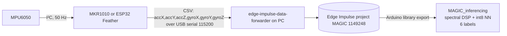
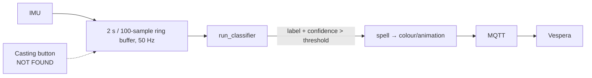

> **AI-generated document — not the author's own work.** Written by Claude (Anthropic, an AI assistant) on 2 Nov 2026 while recovering this project from the author's PC, before the v4 sketch was found. It is kept for reference only. Statements about who wrote which file are superseded by `docs/ai-contributions.md`; current status is in `README.md` and `docs/testing.md`.

# Architecture

Three architectures appear in the recovered code. Only the first two exist as complete sketches, and none has a recorded hardware run.

## A. Implemented: threshold wand → Vespera (firmware/03)

```mermaid
flowchart LR
  IMU[MPU6050<br/>±2 g, ±250 °/s, DLPF 3] -- I²C 0x68, 14-byte burst / 25 ms --> MCU
  subgraph MCU[Arduino MKR WiFi 1010]
    D[detectMovement<br/>max|gyro| > 60 °/s OR Σ|Δacc| > 0.35 g] --> H[2 s hold state]
    H --> R[makeRainbow every 300 ms<br/>or one makeOff]
  end
  R -- 216-byte RGB frame --> W[WiFiNINA] --> B[(MQTT broker<br/>mqtt.cetools.org:1884)]
  B -- topic student/CASA0014/luminaire/11 --> V[Vespera luminaire<br/>72 px]
```

## B. Implemented: training-data capture (firmware/04 and firmware/05)


Units differ: the MKR version outputs m/s², the ESP32 version outputs g. See debugging-log D4.

## C. Not implemented: intended ML wand → Vespera


No code for this exists on the PC. The parts that exist are the model library, a known-input test sketch, and the MQTT/Vespera publishing code from A.

## Hardware (from the code)
| Item | Evidence |
|---|---|
| Arduino MKR WiFi 1010 (SAMD21 Cortex-M0+, NINA-W102 Wi-Fi) | FQBN `arduino:samd:mkrwifi1010` in build configs; WiFiNINA use |
| Adafruit ESP32 Feather (HUZZAH32) | Comment in `sketch_nov1a`; SDA 23 / SCL 22; ESP32 core install (AI-reported) |
| GY-521 MPU6050 breakout on I²C (0x68, 0x69 fallback in the MKR collector) | Code |
| Vespera luminaire #11 (72 RGB px via MQTT) | Topic and payload in code |
| Wiring diagram, power and enclosure | **Not found.** To be documented by the author |
